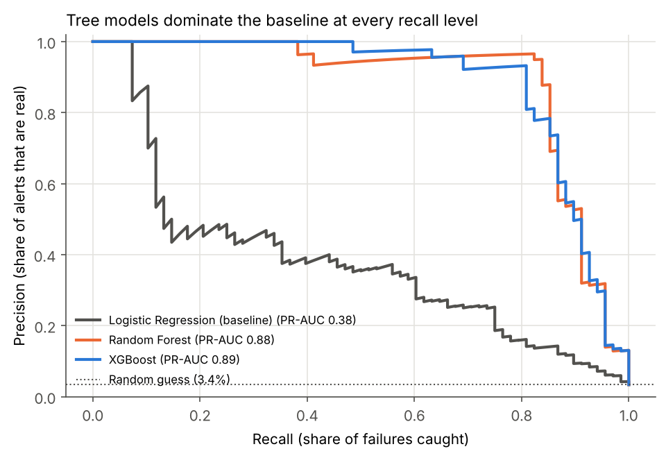
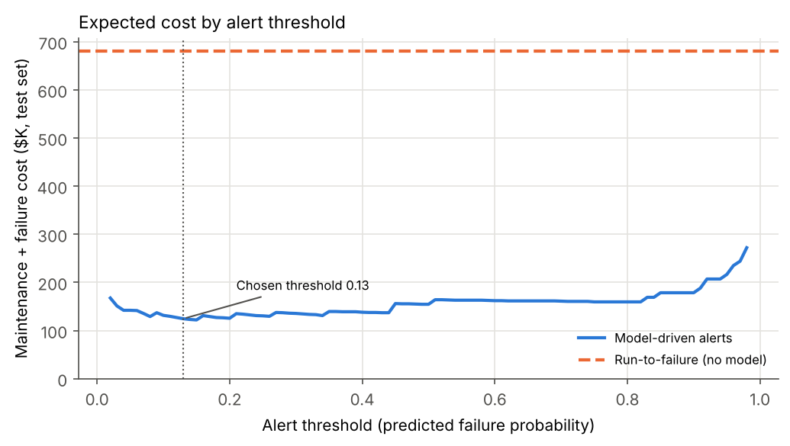
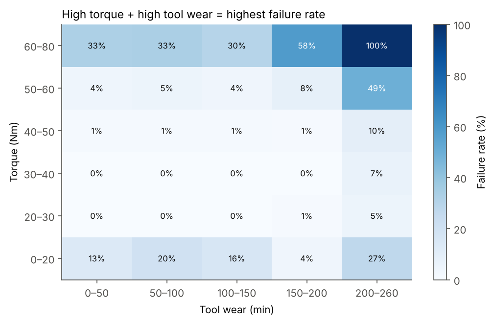
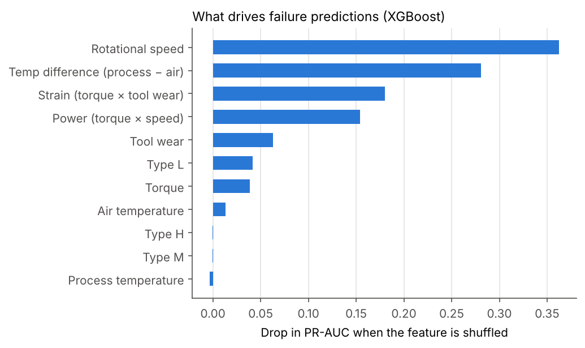

# Predictive Maintenance: Machine Failure Prediction

[](https://github.com/nKanjilal/predictive-maintenance/actions/workflows/ci.yml)

Predicts whether a milling machine is about to fail from five sensor readings, then turns the model into a maintenance alert policy that a plant could actually run.

**Data:** [AI4I 2020 Predictive Maintenance Dataset](https://archive.ics.uci.edu/dataset/601) (UCI) — 10,000 machine cycles, 339 failures (3.4%).
**Stack:** Python, Pandas, scikit-learn, XGBoost, Matplotlib, Streamlit

## Results

| Model (test set, 2,000 cycles, 68 failures) | Precision | Recall | F1 | PR-AUC |
|---|---|---|---|---|
| Logistic regression (baseline, raw sensors) | 0.38 | 0.37 | 0.37 | 0.38 |
| Logistic regression + engineered features | 0.53 | 0.37 | 0.43 | 0.43 |
| Random forest | 0.95 | 0.82 | 0.88 | 0.88 |
| **XGBoost (selected)** | **0.93** | **0.81** | **0.87** | **0.89** |

- XGBoost beats the logistic regression baseline by **49 points of F1** (0.87 vs 0.37). Random forest is statistically tied; XGBoost was selected on PR-AUC.
- **Accuracy is misleading here.** A model that always predicts "no failure" scores 96.6% accuracy and catches nothing. The baseline logistic regression scores 95.8%, *worse than doing nothing*, despite catching some failures. That's why every model is compared on precision, recall, F1 and PR-AUC.



## Operations recommendation

The model outputs a failure probability; the plant needs a yes/no "pull this machine for maintenance" rule. I chose the alert threshold by minimizing expected cost on cross-validated **training** predictions (the test set was never used to tune it), with these assumptions:

| Assumption | Value |
|---|---|
| Cost of an unplanned failure (downtime, scrap, emergency repair) | $10,000 |
| Cost of one alert (planned inspection / tool change) | $500 |

**Recommended alert threshold: 0.13** → on the held-out test set:

- Catches **62 of 68 failures (91%)** before breakdown
- 129 alerts across 2,000 cycles (~6.5 per 100 cycles); 48% of alerts are real failures
- Expected cost **$124.5K vs $680K** for run-to-failure, an **82% reduction** under the assumptions above
- Catches **100%** of heat-dissipation, power and overstrain failures; **6 of 10** tool-wear failures (tool wear failures happen at a random point between 200–240 min, so they're inherently harder to time)

The threshold is low because a missed failure costs 20× an inspection — it's worth tolerating false alarms. If inspections were more expensive, the trade-off table shows where to move it:

| Threshold | Failures caught | Recall | False alarms | Precision |
|---|---|---|---|---|
| 0.1 | 62 | 91% | 81 | 43% |
| 0.2 | 61 | 90% | 50 | 55% |
| 0.3 | 59 | 87% | 32 | 65% |
| 0.5 | 56 | 82% | 13 | 81% |
| 0.8 | 55 | 81% | 4 | 93% |



## What drives failure

Permutation importance on the test set (how much PR-AUC drops when a feature is scrambled):

1. **Rotational speed** — very low or very high speed drives power and heat failures
2. **Temperature difference (process − air)** — a small gap means poor heat dissipation
3. **Strain (torque × tool wear)** — a worn tool under high torque overstrains
4. **Power (torque × speed)** — failures happen outside a ~3.5–9 kW operating band

Raw torque and tool wear matter mostly *through* the engineered interactions: failure rate is ~1% at moderate torque and wear, but **49–100% when torque is above 50 Nm and tool wear is past 200 min**. Adding the three physics-based features also lifted logistic regression's F1 from 0.37 to 0.43.




## Method

1. **Explore** (`src/eda.py`) — failure rate by tool wear and torque bins, the torque × wear interaction, and failure-mode counts.
2. **Handle imbalance** — 28.5 healthy cycles for every failure. Used class weights (`class_weight="balanced"` for logistic regression and random forest, `scale_pos_weight=28.5` for XGBoost) so the 271 training failures carry as much total weight as the 7,729 healthy cycles, without generating synthetic data. Stratified 80/20 split keeps the 3.4% failure rate in both sets.
3. **Prevent leakage** — dropped `UDI` and `Product ID` (identifiers) and the five failure-mode flags (`TWF`, `HDF`, `PWF`, `OSF`, `RNF`), which are the answer in disguise.
4. **Engineer features** — temperature difference, mechanical power (torque × rpm × 2π/60), and strain (torque × tool wear).
5. **Train & compare** (`src/train.py`) — logistic regression baseline, random forest and XGBoost. Each model's F1-optimal threshold is chosen on 5-fold out-of-fold training predictions, then evaluated once on the test set.
6. **Explain & recommend** — permutation importance, cost-based alert threshold, catch rate by failure mode.
7. **Deploy** — the final model is refit on all 10,000 rows and served in a Streamlit app.

**Limitations:** the dataset is synthetic (it models a real milling machine but the failure rules are simulated), each row is an independent snapshot rather than a time series, and the cost figures are assumptions to replace with real plant data.

## Run it

```bash
pip install -r requirements.txt
python src/eda.py        # charts → reports/figures/
python src/train.py      # models, metrics → reports/, model → models/model.joblib
streamlit run app.py     # interactive risk calculator
pytest -v                # data quality, feature, and model tests
```

## Testing & CI

Every push and pull request to `main` runs a GitHub Actions workflow (`.github/workflows/ci.yml`) that installs the dependencies and runs the test suite in `tests/`. The tests check:

- **Data quality:** expected row count and columns, no missing model inputs, sensor values in physical ranges, and the failure rate staying near 3.4%
- **Feature engineering:** temperature difference, power, and strain match their formulas, and no failure labels leak into the model inputs
- **Model:** the saved model loads, returns valid probabilities, and scores an overstrained machine as riskier than a normal one
- **Reported results:** the metrics in `reports/metrics.json` still meet the recall and precision targets

## Repo layout

```
data/ai4i2020.csv            raw dataset (UCI, CC BY 4.0)
src/features.py              loading + feature engineering (shared by training and app)
src/eda.py                   exploratory charts
src/train.py                 imbalance handling, model comparison, drivers, alert threshold
app.py                       Streamlit app: sensor readings in, failure risk out
models/model.joblib          trained XGBoost model + alert threshold
tests/test_pipeline.py       automated data, feature, and model tests
.github/workflows/ci.yml     GitHub Actions CI: runs the tests on every push and pull request
reports/metrics.json         all metrics
reports/*.csv                model comparison, feature importance, threshold trade-off
reports/figures/             charts
```

Dataset citation: Matzka, S. (2020). AI4I 2020 Predictive Maintenance Dataset. UCI Machine Learning Repository. https://doi.org/10.24432/C5HS5C
